# PostgreSQL schema (D-01)

Authoritative DDL: `docs/database/schema_postgres.sql` (PostgreSQL 16, 36 tables, 15 enum types). It replaces `scheme_mysql.sql`, which is obsolete (decision D16).
Behavioural tests: `scripts/test_schema.sql`. ERD below is generated from a live database by `scripts/gen_erd.py`; the source is `docs/database/erd.mmd`.

## Conventions
- snake_case, plural table names except where noted in the DDL; `GENERATED ALWAYS AS IDENTITY` keys; `TIMESTAMPTZ`; enums as PostgreSQL types.
- Every user-owned table references `users(id)` with `ON DELETE CASCADE`, so deleting a user (FR-U5) removes all personal data. MongoDB documents and photo files are removed by the API in the same request.
- Offline-capable tables (`workout_log`, `nutrition_log`, `body_metrics`) have `client_uuid`, `updated_at` (set by trigger `set_updated_at()`, client value is ignored) and `deleted_at` (tombstone).
- Sync cursor: use `updated_at` with a small overlap window (re-read rows from `cursor - 2 s`) and deduplicate by `client_uuid`; pull returns tombstones.
- Equipment order for filtering: `none < home < gym`. A user with `gym` may use exercises of all three; `home` uses `none` and `home`; `none` uses `none`.
- Injury exclusion: see `docs/algorithms.md` section 4.3 (explicit exclusions table, main group equals affected group, secondary group at moderate or severe). The rule is implemented once, in the API; the DB only stores the data.
- One active and one draft training plan and diet plan per user (partial unique indexes). `skipped_muscle_group_ids` on `training_plan` records groups skipped for FR-P3 or injuries.
- Value ranges (CHECK): weight 30-300, age 16-100, height 120-250, RPE 1-10, hunger 1-10, `day_index` 1-7.

## Changes against the old MySQL ERD

| # | Problem | Change |
| - | ------- | ------ |
| 1 | `User.password_hash` has a UNIQUE index | drop it |
| 2 | All FKs are `ON DELETE NO ACTION`, which blocks FR-U5 account deletion | `ON DELETE CASCADE` for all user-owned tables |
| 3 | `user` is a reserved word; PascalCase and `User_idUser` naming | D8 naming |
| 4 | `UserProfile` has no experience level or equipment, both needed by FR-P1; `target_type DECIMAL` is unclear | add `experience_level`, `equipment`; rename to `target_weight_kg` (needed by FR-R4, confirm meaning) |
| 5 | Goal enum typo `edurance` in three tables | `endurance` |
| 6 | No allergens/intolerances (FR-P6, FR-N3) | add `allergen`, `user_allergen`, `food_item_allergen` |
| 7 | `Injury.injury_type` VARCHAR duplicates the FK; `affected_muscle_group` is free text | remove VARCHAR, FK to `muscle_group` |
| 8 | Nothing links injuries to excluded exercises (FR-P2 acceptance) | add `injury_type_excluded_exercise` (or rule by muscle group + severity, decide here) |
| 9 | `Exercise.main/secondary_muscle_group` VARCHARs duplicate `Exercise_has_MuscleGroup`; `required_equipment` is free text and cannot be filtered | main muscle group FK, secondary via junction, `equipment` as enum (gym/home/none); name length 100 |
| 10 | `BodyMetrics` primary key is the user only, so only one row per user and no history; weight is INT | surrogate PK plus unique `(user_id, measured_on)`; weight `DECIMAL(5,2)` |
| 11 | `WorkoutLog` holds one set/reps/weight value per session; the junction table has no data | `workout_log` (session level) plus `workout_set_log` (exercise, set no, reps, weight, rpe, completed) for FR-A2/A4/A5, tonnage and PR |
| 12 | FR-A4 changes must be explainable | add `plan_adjustment` (session_exercise, reason, old/new values) |
| 13 | `Meal.time` is a DATE; `FoodItem` carries `Meal_idMeal`/`Meal_DietPlan_idDietPlan`, which breaks the M:N relation | fix time type and day index; remove those FK columns from `food_item` |
| 14 | `Meal_has_FoodItem` and `NutritionLog_has_FoodItem` have no `grams` | add `grams` and computed macros |
| 15 | `FoodItem.category` VARCHAR duplicates `FoodCategory` | drop it; add `default_portion_g` and nullable unique `recognition_label` for AI mapping |
| 16 | `NutritionLog.RecognitionAI` FK is NOT NULL (blocks manual logs); hunger columns NOT NULL | make nullable; add nullable `meal_id` (planned meal) for FR-R2 diet compliance |
| 17 | `ProgressReport.estimated_goal_completion_date` NOT NULL (FR-R4/R5 need "no prediction"); no diet compliance; `raport_type` typo | nullable; add diet/workout compliance %; `report_type` |
| 18 | `Notification` is not suitable for local reminders (`is_sent`, `is_dismissed`) | add `recurrence`, `is_enabled`; add `device_push_token` |
| 19 | Missing auth tables | `password_reset_token` (FR-U3), `refresh_token` (B-02), `oauth_identity` (FR-U8) |

## ERD

```mermaid
erDiagram
  allergen {
    integer id PK
    text name
    text description
  }
  body_metrics {
    bigint id PK
    bigint user_id
    uuid client_uuid
    date measured_on
    numeric weight_kg
    numeric chest_cm
    numeric waist_cm
    numeric thigh_cm
    numeric bicep_cm
    numeric hip_cm
    numeric calf_cm
    numeric body_fat_percent
    timestamp_with_time_zone created_at
    timestamp_with_time_zone updated_at
    timestamp_with_time_zone deleted_at
  }
  device_push_token {
    bigint id PK
    bigint user_id
    text token
    text platform
    timestamp_with_time_zone created_at
    timestamp_with_time_zone last_seen_at
  }
  diet_plan {
    bigint id PK
    bigint user_id
    text name
    goal_t goal
    diet_type_t diet_type
    smallint meals_per_day
    plan_status_t status
    integer daily_calorie_target
    numeric protein_target_g
    numeric fat_target_g
    numeric carbs_target_g
    text dietary_restrictions
    timestamp_with_time_zone generated_at
    date start_date
    date end_date
  }
  exercise {
    integer id PK
    text name
    integer main_muscle_group_id
    experience_level_t difficulty_level
    equipment_t equipment
    boolean is_compound
    boolean is_bodyweight
    text description
    text instruction
  }
  exercise_secondary_muscle_group {
    integer exercise_id PK
    integer muscle_group_id PK
  }
  food_category {
    integer id PK
    text name
    text description
  }
  food_category_food_item {
    integer food_category_id PK
    integer food_item_id PK
  }
  food_item {
    integer id PK
    text name
    numeric calories_per_100g
    numeric protein_per_100g
    numeric fat_per_100g
    numeric carbs_per_100g
    food_role_t role
    ARRAY suitable_meal_types
    boolean is_vegetarian
    boolean is_vegan
    integer default_portion_g
    integer min_portion_g
    integer max_portion_g
    integer portion_step_g
    text recognition_label
    boolean is_active
  }
  food_item_allergen {
    integer food_item_id PK
    integer allergen_id PK
  }
  injury {
    bigint id PK
    bigint user_id
    integer injury_type_id
    integer affected_muscle_group_id
    severity_t severity
    date start_date
    boolean is_active
    text notes
    timestamp_with_time_zone created_at
    timestamp_with_time_zone updated_at
  }
  injury_type {
    integer id PK
    text name
    text description
    integer avg_healing_time_days
  }
  injury_type_excluded_exercise {
    integer injury_type_id PK
    integer exercise_id PK
  }
  meal {
    bigint id PK
    bigint diet_plan_id
    smallint day_index
    meal_type_t meal_type
    smallint meal_order
    time_without_time_zone scheduled_time
    numeric planned_calories
    numeric planned_protein_g
    numeric planned_fat_g
    numeric planned_carbs_g
  }
  meal_food_item {
    bigint meal_id PK
    integer food_item_id PK
    numeric grams
  }
  muscle_group {
    integer id PK
    text name
    text description
    text image_url
    body_region_t body_region
  }
  notification {
    bigint id PK
    bigint user_id
    notification_type_t type
    text title
    text message
    jsonb data
    timestamp_with_time_zone created_at
    timestamp_with_time_zone sent_at
    timestamp_with_time_zone read_at
  }
  nutrition_log {
    bigint id PK
    bigint user_id
    uuid client_uuid
    date log_date
    meal_type_t meal_type
    text meal_photo_url
    numeric actual_calories
    numeric actual_protein_g
    numeric actual_fat_g
    numeric actual_carbs_g
    smallint hunger_level_before
    smallint hunger_level_after
    bigint planned_meal_id
    bigint recognition_id
    timestamp_with_time_zone logged_at
    timestamp_with_time_zone created_at
    timestamp_with_time_zone updated_at
    timestamp_with_time_zone deleted_at
  }
  nutrition_log_food_item {
    bigint nutrition_log_id PK
    integer food_item_id PK
    numeric grams
    numeric calories
    numeric protein_g
    numeric fat_g
    numeric carbs_g
  }
  oauth_identity {
    bigint id PK
    bigint user_id
    oauth_provider_t provider
    text provider_subject
    text email
    timestamp_with_time_zone created_at
  }
  password_reset_token {
    bigint id PK
    bigint user_id
    text token_hash
    timestamp_with_time_zone expires_at
    timestamp_with_time_zone used_at
    timestamp_with_time_zone created_at
  }
  personal_record {
    bigint id PK
    bigint user_id
    integer exercise_id
    numeric max_weight_kg
    smallint max_reps
    numeric estimated_1rm_kg
    date achieved_on
    boolean is_current
    bigint source_set_id
  }
  plan_adjustment {
    bigint id PK
    bigint session_exercise_id
    bigint workout_log_id
    adjustment_reason_t reason
    smallint old_sets
    smallint new_sets
    smallint old_reps
    smallint new_reps
    numeric old_weight_kg
    numeric new_weight_kg
    timestamp_with_time_zone created_at
  }
  progress_report {
    bigint id PK
    bigint user_id
    report_type_t report_type
    date period_start
    date period_end
    numeric weight_difference_kg
    numeric training_volume_kg
    smallint training_sessions_completed
    smallint training_sessions_planned
    numeric workout_compliance_pct
    numeric diet_compliance_pct
    integer avg_daily_calories
    date estimated_goal_completion_date
    boolean irregular_data
    boolean is_auto
    jsonb details
    timestamp_with_time_zone generated_at
  }
  recognition_ai {
    bigint id PK
    bigint user_id
    text image_url
    text model_name
    text model_version
    timestamp_with_time_zone uploaded_at
    jsonb recognized_items
    integer estimated_calories
    numeric estimated_protein_g
    numeric estimated_fat_g
    numeric estimated_carbs_g
    numeric confidence_score
    boolean was_edited
    timestamp_with_time_zone created_at
  }
  refresh_token {
    bigint id PK
    bigint user_id
    uuid family_id
    text token_hash
    timestamp_with_time_zone expires_at
    timestamp_with_time_zone revoked_at
    text device_label
    timestamp_with_time_zone created_at
  }
  reminder {
    bigint id PK
    bigint user_id
    notification_type_t type
    meal_type_t meal_type
    ARRAY weekdays
    time_without_time_zone time_of_day
    text message
    boolean is_enabled
    timestamp_with_time_zone created_at
    timestamp_with_time_zone updated_at
  }
  session_exercise {
    bigint id PK
    bigint training_session_id
    integer exercise_id
    integer original_exercise_id
    smallint position
    smallint planned_sets
    smallint planned_reps
    numeric planned_weight_kg
    smallint rest_seconds
  }
  training_plan {
    bigint id PK
    bigint user_id
    text name
    goal_t goal
    smallint num_training_days
    experience_level_t experience_level
    equipment_t equipment
    plan_status_t status
    ARRAY skipped_muscle_group_ids
    timestamp_with_time_zone generated_at
    date start_date
    date end_date
  }
  training_session {
    bigint id PK
    bigint training_plan_id
    smallint session_order
    text name
    weekday_t weekday
    smallint estimated_duration_min
  }
  user_allergen {
    bigint user_id PK
    integer allergen_id PK
  }
  user_excluded_food {
    bigint user_id PK
    integer food_item_id PK
  }
  user_profile {
    bigint user_id PK
    smallint age
    sex_t sex
    numeric weight_kg
    smallint height_cm
    numeric activity_level_pal
    goal_t goal
    numeric target_weight_kg
    experience_level_t experience_level
    equipment_t equipment
    integer tdee_kcal
    timestamp_with_time_zone created_at
    timestamp_with_time_zone updated_at
  }
  users {
    bigint id PK
    text email
    text password_hash
    text name
    text surname
    text timezone
    boolean is_active
    timestamp_with_time_zone email_verified_at
    timestamp_with_time_zone created_at
    timestamp_with_time_zone updated_at
  }
  workout_log {
    bigint id PK
    bigint user_id
    uuid client_uuid
    bigint training_session_id
    date performed_on
    timestamp_with_time_zone started_at
    timestamp_with_time_zone finished_at
    smallint overall_rpe
    text notes
    timestamp_with_time_zone created_at
    timestamp_with_time_zone updated_at
    timestamp_with_time_zone deleted_at
  }
  workout_set_log {
    bigint id PK
    bigint workout_log_id
    integer exercise_id
    bigint session_exercise_id
    smallint set_number
    smallint reps
    numeric weight_kg
    smallint rpe
    boolean completed
  }
  users ||--o{ body_metrics : "user_id"
  users ||--o{ device_push_token : "user_id"
  users ||--o{ diet_plan : "user_id"
  muscle_group ||--o{ exercise : "main_muscle_group_id"
  exercise ||--o{ exercise_secondary_muscle_group : "exercise_id"
  muscle_group ||--o{ exercise_secondary_muscle_group : "muscle_group_id"
  food_category ||--o{ food_category_food_item : "food_category_id"
  food_item ||--o{ food_category_food_item : "food_item_id"
  allergen ||--o{ food_item_allergen : "allergen_id"
  food_item ||--o{ food_item_allergen : "food_item_id"
  muscle_group ||--o{ injury : "affected_muscle_group_id"
  injury_type ||--o{ injury : "injury_type_id"
  users ||--o{ injury : "user_id"
  exercise ||--o{ injury_type_excluded_exercise : "exercise_id"
  injury_type ||--o{ injury_type_excluded_exercise : "injury_type_id"
  diet_plan ||--o{ meal : "diet_plan_id"
  food_item ||--o{ meal_food_item : "food_item_id"
  meal ||--o{ meal_food_item : "meal_id"
  users ||--o{ notification : "user_id"
  meal ||--o{ nutrition_log : "planned_meal_id"
  recognition_ai ||--o{ nutrition_log : "recognition_id"
  users ||--o{ nutrition_log : "user_id"
  food_item ||--o{ nutrition_log_food_item : "food_item_id"
  nutrition_log ||--o{ nutrition_log_food_item : "nutrition_log_id"
  users ||--o{ oauth_identity : "user_id"
  users ||--o{ password_reset_token : "user_id"
  exercise ||--o{ personal_record : "exercise_id"
  workout_set_log ||--o{ personal_record : "source_set_id"
  users ||--o{ personal_record : "user_id"
  session_exercise ||--o{ plan_adjustment : "session_exercise_id"
  workout_log ||--o{ plan_adjustment : "workout_log_id"
  users ||--o{ progress_report : "user_id"
  users ||--o{ recognition_ai : "user_id"
  users ||--o{ refresh_token : "user_id"
  users ||--o{ reminder : "user_id"
  exercise ||--o{ session_exercise : "exercise_id"
  exercise ||--o{ session_exercise : "original_exercise_id"
  training_session ||--o{ session_exercise : "training_session_id"
  users ||--o{ training_plan : "user_id"
  training_plan ||--o{ training_session : "training_plan_id"
  allergen ||--o{ user_allergen : "allergen_id"
  users ||--o{ user_allergen : "user_id"
  food_item ||--o{ user_excluded_food : "food_item_id"
  users ||--o{ user_excluded_food : "user_id"
  users ||--o{ user_profile : "user_id"
  training_session ||--o{ workout_log : "training_session_id"
  users ||--o{ workout_log : "user_id"
  exercise ||--o{ workout_set_log : "exercise_id"
  session_exercise ||--o{ workout_set_log : "session_exercise_id"
  workout_log ||--o{ workout_set_log : "workout_log_id"
```

